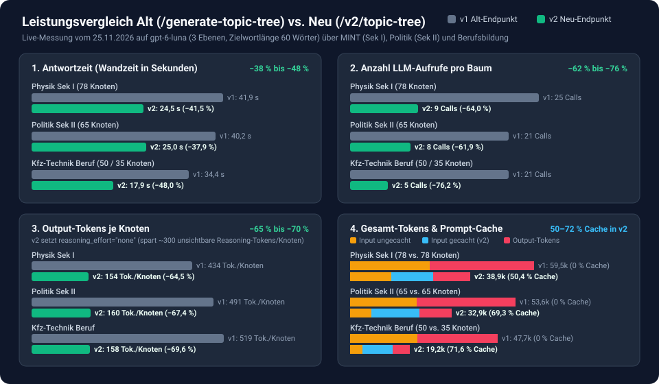

# Änderungen gegenüber `backup_old` (`v0.4.0`, Stand 29.10.2026 → `v2.0.0`)

Kompakte Übersicht aller funktionalen, architektonischen und betrieblichen Änderungen zwischen dem bisherigen GitLab-Stand **`v0.4.0`** (Branch `backup_old`, Commit `8e702f0` / GitLab `b0942215` vom 29.10.2026) und **`v2.0.0`** (`main` bzw. GitLab-Branch `v2`).

---

## Eckdaten auf einen Blick

| Bereich | `v0.4.0` (`backup_old`, 29.10.2026) | `v2.0.0` (`main` / GitLab `v2`, 25.11.2026) |
|---|---|---|
| **Fachliche Endpunkte** | `POST /generate-topic-tree`, `POST /generate-collection-description` | **Neu:** `POST /v2/topic-tree` + beide v1-Endpunkte **100 % kompatibel erhalten** |
| **Anwendungsfälle** | Nur Neugenerierung aus Freitext-Thema | **4 Use Cases:** `topic`, `document`, `folders`, `contents` + Überarbeitung (`mode: refine`, `assign_only`) |
| **LLM-Pipeline (3 Ebenen)** | 21–49 sequenzielle/verschachtelte Einzelaufrufe, 0 % Prompt-Cache | **1 Skeleton-Call + parallele 10er-Batches** (5–9 Calls), **50–72 % Prompt-Cache**, **−65 bis −70 % Output-Tokens/Knoten** |
| **Laufzeit & Server** | `fastapi run main.py` (Single-Process, Port `8000`) | `gunicorn` + `uvicorn-worker` (`graceful_timeout=290s`), **2 Ports** (`:8000` öffentlich, `:9000` intern) |
| **Vokabulare (SKOS)** | Live-Download von `vocabs.openeduhub.de` beim Start (DE/EN zufällig) | **Gebündelter Offline-Snapshot** im Image (kein Start-Netzwerkzugriff, zuverlässig Deutsch) |
| **Betrieb & Monitoring** | Nur `/_ping`, kein `/metrics`, kein B3-Tracing, kein Helm-Chart im Repo | `/health`, `/ready`, Prometheus `/metrics` (Multiprocess), JSON-Logs + B3-Tracing, **Helm-Chart inkl. NetworkPolicy & Alarmregeln** |
| **Automatisierte Tests** | 3 Testdateien | **465 Tests** (Unit, Schema, Auth, Resilienz, Helm-Chart, E2E) |

---

## 1. Neue Funktionalität in `POST /v2/topic-tree`

- **Vier fachliche Einstiege (`use_case`):**
  1. **`topic`** – Themenbaum aus Thema, Zielgruppe, Bildungsstufe und optionalen Strukturhinweisen.
  2. **`document`** – Strukturierung entlang eines Lehrplans, Skripts oder Gliederungstexts (inline oder per SSRF-geschützter `ref`-URL).
  3. **`folders`** – Bereinigung und Vereinheitlichung bestehender Ordnerbäume.
  4. **`contents`** – Aufbau eines Themenbaums aus vorhandenen Materialien (`nodeId`, Titel, Kurztext, Keywords) inkl. automatischer **Materialzuordnung mit Konfidenzwert** und Sammelordner für Unzugeordnetes.
- **Gezieltes Überarbeiten (`mode: "refine"` & `assign_only`):**
  - Strukturierte Änderungsoperationen (`rename`, `delete`, `move`, `merge`, `set_description`, `set_keywords`, `assign`, `unassign`) laufen **rein deterministisch in Code (0 LLM-Aufrufe, Millisekunden)**.
  - Nur inhaltlich neue Zweige (`add_branch`, `split` oder Freitext-Feedback) rufen gezielt für die betroffenen Knoten das LLM auf – bestehende Knoten und stabile `key`-IDs bleiben unverändert.
  - `assign_only: true` ordnet neue Inhalte einem bestehenden Baum zu, ohne dessen Struktur zu verändern.
- **Verlässliche Struktur & Transparenz statt stiller Lücken:**
  - Kanonische Zusatzthemen (`Allgemeines`, `Methodik und Didaktik`) zählen einheitlich in `shape.main_topics` hinein; ohne explizites `shape` skaliert die Breite bei `document`/`contents`/`folders` eingabegetrieben bis 20 Knoten pro Ebene (bei `topic`: Empfehlung 5–15).
  - Deterministische Duplikatbereinigung über den gesamten Baum.
  - Jeder Teilfehler, verworfene Vorschlag oder degradierte Fallback (`LLM_DEGRADED` bei `document`/`folders` ohne verfügbares LLM) erscheint explizit in `warnings[]`; unklare Vorgaben liefern konkrete Rückfragen in `questions[]`.
- **Abschaltbare Test- & Demo-Oberfläche (`/ui/`):**
  - Interaktive Vorschau mit Beispielszenarien für alle Use Cases, Metrik-/Token-Anzeige und Refine-Workflow (`UI_ENABLED=true` lokal, im Helm-Chart standardmäßig `false`).

---

## 2. Abwärtskompatibilität der Bestands-Endpunkte (v1)

- **`POST /generate-topic-tree`** und **`POST /generate-collection-description`** bleiben unter `app/legacy/` mit **unverändertem Request- und Response-Schema** erhalten – bestehende Aufrufer (edu-sharing / b-api) benötigen keine Anpassung.
- Unter der Haube profitieren auch die v1-Endpunkte nun von:
  - konsistenter Authentifizierung im `bapi`-, `standalone`- und `auto`-Modus (inkl. direkter Testbarkeit über `/docs` mit lokalem Key),
  - durchgängiger Weiterleitung von B3- und `x-client-trace-id`-Headern,
  - gemeinsamem Prozess-Concurrency-Limit (`LLM_MAX_CONCURRENCY`) und
  - bereinigten Fehlermeldungen (keine ungefilterten Exception-Strings in `500`-Antworten, kein Klartext-Logging von Nutzereingaben).

---

## 3. Geschwindigkeit, Tokenverbrauch & Qualität

Direktvergleich über drei Fächer (Physik Sek I, Politik Sek II, Kfz-Mechatronik) auf `gpt-6-luna` (Details in [2026-11-25-v1-vs-v2-comparison.md](measurements/2026-11-25-v1-vs-v2-comparison.md)):

- **38–48 % kürzere Antwortzeit** (z. B. 78 Knoten in **24,5 s** statt 41,9 s).
- **62–76 % weniger LLM-Aufrufe** (1 kompletter Titel-Entwurf + parallele 10er-Beschreibungs-Batches statt 21–25 Einzelaufrufen).
- **60–68 % geringere Tokenkosten pro Baum:**
  - **−65 bis −70 % Output-Tokens je Knoten** (`154–160` statt `434–519`), da v2 `reasoning_effort="none"` für `gpt-5`/`gpt-6`-Modelle setzt und unsichtbaren Reasoning-Overhead vermeidet.
  - **50–72 % Prompt-Cache-Quote** (statt `0 %` in v1) durch einen statischen Systemprompt (`app/prompts/system.md`) und geteilte Batch-Präfixe.
- **Höhere fachliche Präzision:** Automatische Erkennung des passenden Ordnungsprinzips (z. B. *Handlungsfeld → Thema → Fachbegriff* in der beruflichen Bildung), prägnante Fachtitel (1–4 Wörter) und enger Wortlängen-Korridor ohne Ausreißer.

---

## 4. Umsetzung des Diensteleitfadens (Architektur, Security & Betrieb)

- **Saubere Schichtenarchitektur (`app/` statt `src/` + `main.py`):** Strikte Trennung in `api/`, `pipeline/`, `domain/`, `schemas/`, `llm/`, `vocab/`, `context/` und `legacy/`. Alle Prompts liegen versioniert unter `app/prompts/`.
- **b-api-Konformität & Security:**
  - Strikte Prüfung und unveränderte Weiterleitung von `Authorization: Bearer bdt_…` im Modus `SERVICE_MODE=bapi` (keine Speicherung, kein Logging, keine `X-API-KEY`-/`X-Edu-*`-Header).
  - Unterstützung von b-api-Routen (`B_API_ROUTE`, Vorlage unter [route-topic-tree-generator.json](../deploy/b-api/route-topic-tree-generator.json) mit `gpt-6-luna` primär und `gpt-5.6-luna` sekundär) sowie Provider-Pfaden (`B_API_MODEL` + `B_API_MODEL_PROVIDER` / `B_API_PROVIDER`).
  - Einheitliches Fehlerformat `{"error": {"code", "message", "trace_id"}}` und saubere Unterscheidung zwischen temporären Ausfällen (`503` + `Retry-After`) und permanenten Modell-/Konfigurationsfehlern (`502` ohne `Retry-After`).
  - SSRF-Schutz für `ref`-Abrufe (`REF_ALLOWED_HOSTS`, Größen- und Zeitlimits).
- **Container, Kubernetes & Observability:**
  - Gehärtetes Multi-Stage-`Dockerfile` mit `@sha256`-Digest-Pinning, Non-Root-User (`uid 10001`) und Read-Only-Root-Dateisystem.
  - Zwei getrennte Ports: öffentlich `:8000` (API + Readiness `/health`) und intern `:9000` (Liveness `/health`, `/ready`, Prometheus `/metrics` multiprocess-fähig).
  - Strukturiertes JSON-Logging auf `stdout` mit B3-Trace-Propagation (`X-B3-TraceId`, `X-B3-SpanId`, `b3`, `x-client-trace-id`).
  - Vollständiges, versioniertes Helm-Chart unter [deploy/helm/topic-tree](../deploy/helm/topic-tree) (`ServiceMonitor`, `PrometheusRule` mit `promtool`-geprüften Alarmen, `NetworkPolicy`, `HorizontalPodAutoscaler`, `terminationGracePeriodSeconds: 300`).
  - Automatisierte CI/CD-Pipelines für GitHub Actions ([.github/workflows/ci.yml](../.github/workflows/ci.yml)) und GitLab CI ([.gitlab-ci.yml](../.gitlab-ci.yml)) inkl. Tag-Versionsprüfung und OCI-Chart-/Image-Build.

---

## 5. Kurzcheckliste für das Update von `v0.4.0` auf `v2.0.0`

1. **Ports & Probes:** Öffentlicher Traffic bleibt auf `:8000`; für Liveness und Prometheus-Scraping steht neu Port `:9000` (`/health`, `/ready`, `/metrics`) bereit.
2. **Betriebsmodus:** Im Cluster hinter der b-api `SERVICE_MODE=bapi` setzen (im Helm-Chart bereits Standard) sowie `UI_ENABLED=false` belassen.
3. **LLM-Ziel an der b-api:** Entweder die Route `topic-tree-generator` gemäß [route-topic-tree-generator.json](../deploy/b-api/route-topic-tree-generator.json) anlegen und `B_API_ROUTE=topic-tree-generator` setzen oder direkt `B_API_MODEL=gpt-6-luna` (`B_API_MODEL_PROVIDER=openai`) nutzen.
4. **Timeouts:** Ingress / Gateway und Pod-Grace-Period auf `300 s` auslegen (passend zu `graceful_timeout=290s` in Gunicorn).
5. **Egress / Netzwerk:** Beim Start ist **kein** Zugriff auf `vocabs.openeduhub.de` mehr nötig – ausgehend reicht im Standardbetrieb ausschließlich die `b-api`.

Weiterführende Details: [Service-Steckbrief](steckbrief.md) · [API-Dokumentation v2](api.md) · [Changelog](../CHANGELOG.md)
