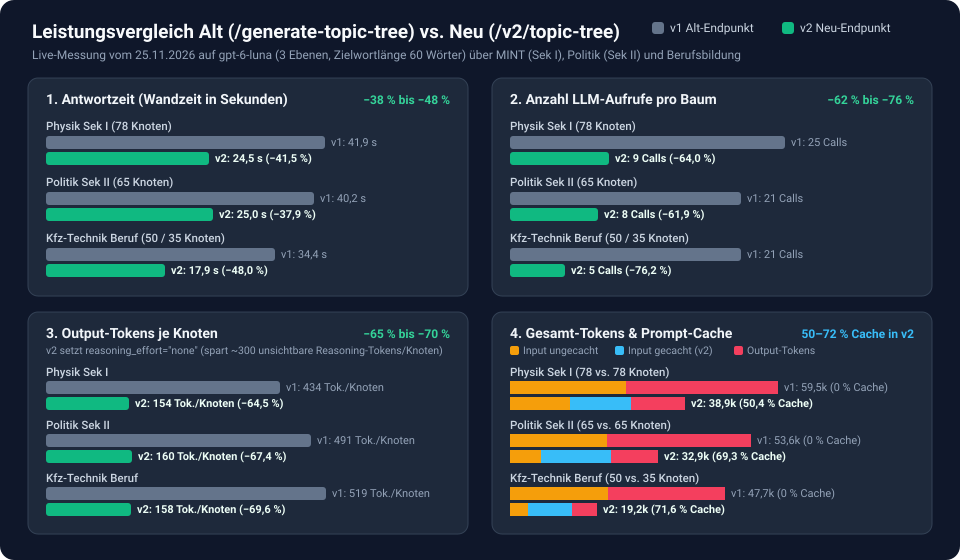

# Changes since `backup_old` (`v0.4.0`, as of 29.10.2026 → `v2.0.0`)

> 🇩🇪 Deutsche Fassung: [`../de/aenderungen-v0.4-zu-v2.0.md`](../de/aenderungen-v0.4-zu-v2.0.md)

Compact overview of all functional, architectural and operational changes between the previous GitLab state **`v0.4.0`** (branch `backup_old`, commit `8e702f0` / GitLab `b0942215` of 29.10.2026) and **`v2.0.0`** (`main` or GitLab branch `v2`).

---

## Key facts at a glance

| Area | `v0.4.0` (`backup_old`, 29.10.2026) | `v2.0.0` (`main` / GitLab `v2`, 25.11.2026) |
|---|---|---|
| **Functional endpoints** | `POST /generate-topic-tree`, `POST /generate-collection-description` | **New:** `POST /v2/topic-tree` + both v1 endpoints kept **100 % compatible** |
| **Use cases** | Only new generation from a free-text topic | **4 use cases:** `topic`, `document`, `folders`, `contents` + revision (`mode: refine`, `assign_only`) |
| **LLM pipeline (3 levels)** | 21–49 sequential/nested single calls, 0 % prompt cache | **1 skeleton call + parallel batches of 10** (5–9 calls), **50–72 % prompt cache**, **−65 to −70 % output tokens per node** |
| **Runtime & server** | `fastapi run main.py` (single process, port `8000`) | `gunicorn` + `uvicorn-worker` (`graceful_timeout=290s`), **2 ports** (`:8000` public, `:9000` internal) |
| **Vocabularies (SKOS)** | Live download from `vocabs.openeduhub.de` at startup (German/English at random) | **Bundled offline snapshot** in the image (no network access at startup, reliably German) |
| **Operations & monitoring** | Only `/_ping`, no `/metrics`, no B3 tracing, no Helm chart in the repo | `/health`, `/ready`, Prometheus `/metrics` (multiprocess), JSON logs + B3 tracing, **Helm chart incl. NetworkPolicy & alert rules** |
| **Automated tests** | 3 test files | **465 tests** (unit, schema, auth, resilience, Helm chart, E2E) |

---

## 1. New functionality in `POST /v2/topic-tree`

- **Four functional entry points (`use_case`):**
  1. **`topic`**: topic tree from topic, audience, education level and optional structure hints.
  2. **`document`**: structuring along a curriculum, script or outline text (inline or via an SSRF-protected `ref` URL).
  3. **`folders`**: cleaning up and harmonising existing folder trees.
  4. **`contents`**: building a topic tree from existing materials (`nodeId`, title, short text, keywords) incl. automatic **material assignment with a confidence value** and a collection folder for unassigned items.
- **Targeted revision (`mode: "refine"` & `assign_only`):**
  - Structured change operations (`rename`, `delete`, `move`, `merge`, `set_description`, `set_keywords`, `assign`, `unassign`) run **purely deterministically in code (0 LLM calls, milliseconds)**.
  - Only new content branches (`add_branch`, `split` or free-text feedback) call the LLM, and only for the affected nodes; existing nodes and stable `key` IDs stay unchanged.
  - `assign_only: true` assigns new contents to an existing tree without changing its structure.
- **Reliable structure & transparency instead of silent gaps:**
  - Canonical extra topics (`Allgemeines`, `Methodik und Didaktik`) count uniformly towards `shape.main_topics`; without an explicit `shape`, the width for `document`/`contents`/`folders` scales with the input up to 20 nodes per level (for `topic`: recommended 5–15).
  - Deterministic duplicate removal across the whole tree.
  - Every partial failure, discarded suggestion or degraded fallback (`LLM_DEGRADED` for `document`/`folders` without an available LLM) appears explicitly in `warnings[]`; unclear instructions yield concrete follow-up questions in `questions[]`.
- **Test & demo UI that can be switched off (`/ui/`):**
  - Interactive preview with example scenarios for all use cases, metrics/token display and refine workflow (`UI_ENABLED=true` locally, `false` by default in the Helm chart).

---

## 2. Backward compatibility of the existing endpoints (v1)

- **`POST /generate-topic-tree`** and **`POST /generate-collection-description`** are kept under `app/legacy/` with **unchanged request and response schemas**; existing callers (edu-sharing / b-api) need no changes.
- Under the hood, the v1 endpoints now also benefit from:
  - consistent authentication in `bapi`, `standalone` and `auto` mode (incl. direct testing via `/docs` with a local key),
  - consistent forwarding of B3 and `x-client-trace-id` headers,
  - a shared per-process concurrency limit (`LLM_MAX_CONCURRENCY`), and
  - cleaned-up error messages (no unfiltered exception strings in `500` responses, no plain-text logging of user input).

---

## 3. Speed, token usage & quality

Direct comparison across three subjects (physics lower secondary, politics upper secondary, automotive mechatronics) on `gpt-6-luna` (details in [2026-11-25-v1-vs-v2-comparison.md](../measurements/2026-11-25-v1-vs-v2-comparison.md)):

- **38–48 % shorter response time** (e.g. 78 nodes in **24.5 s** instead of 41.9 s).
- **62–76 % fewer LLM calls** (1 complete title draft + parallel description batches of 10 instead of 21–25 single calls).
- **60–68 % lower token cost per tree:**
  - **−65 to −70 % output tokens per node** (`154–160` instead of `434–519`), because v2 sets `reasoning_effort="none"` for `gpt-5`/`gpt-6` models and avoids invisible reasoning overhead.
  - **50–72 % prompt cache rate** (instead of `0 %` in v1) thanks to a static system prompt (`app/prompts/system.md`) and shared batch prefixes.
- **Higher subject precision:** automatic detection of the fitting ordering principle (e.g. *field of action → topic → technical term* in vocational education), concise subject titles (1–4 words) and a narrow word-length corridor without outliers.

---

## 4. Implementation of the service guideline (architecture, security & operations)

- **Clean layered architecture (`app/` instead of `src/` + `main.py`):** strict separation into `api/`, `pipeline/`, `domain/`, `schemas/`, `llm/`, `vocab/`, `context/` and `legacy/`. All prompts are versioned under `app/prompts/`.
- **b-api conformity & security:**
  - Strict checking and unchanged forwarding of `Authorization: Bearer bdt_…` in mode `SERVICE_MODE=bapi` (no storage, no logging, no `X-API-KEY`/`X-Edu-*` headers).
  - Support for b-api routes (`B_API_ROUTE`, template in [route-topic-tree-generator.json](../../deploy/b-api/route-topic-tree-generator.json) with `gpt-6-luna` as primary and `gpt-5.6-luna` as secondary) and provider paths (`B_API_MODEL` + `B_API_MODEL_PROVIDER` / `B_API_PROVIDER`).
  - Uniform error format `{"error": {"code", "message", "trace_id"}}` and a clear distinction between temporary outages (`503` + `Retry-After`) and permanent model/configuration errors (`502` without `Retry-After`).
  - SSRF protection for `ref` fetches (`REF_ALLOWED_HOSTS`, size and time limits).
- **Container, Kubernetes & observability:**
  - Hardened multi-stage `Dockerfile` with `@sha256` digest pinning, non-root user (`uid 10001`) and read-only root file system.
  - Two separate ports: public `:8000` (API + readiness `/health`) and internal `:9000` (liveness `/health`, `/ready`, multiprocess-capable Prometheus `/metrics`).
  - Structured JSON logging to `stdout` with B3 trace propagation (`X-B3-TraceId`, `X-B3-SpanId`, `b3`, `x-client-trace-id`).
  - Complete, versioned Helm chart under [deploy/helm/topic-tree](../../deploy/helm/topic-tree) (`ServiceMonitor`, `PrometheusRule` with `promtool`-checked alerts, `NetworkPolicy`, `HorizontalPodAutoscaler`, `terminationGracePeriodSeconds: 300`).
  - Automated CI/CD pipelines for GitHub Actions ([.github/workflows/ci.yml](../../.github/workflows/ci.yml)) and GitLab CI ([.gitlab-ci.yml](../../.gitlab-ci.yml)) incl. tag version check and OCI chart/image build.

---

## 5. Short checklist for the update from `v0.4.0` to `v2.0.0`

1. **Ports & probes:** public traffic stays on `:8000`; port `:9000` (`/health`, `/ready`, `/metrics`) is new for liveness and Prometheus scraping.
2. **Operating mode:** in the cluster behind the b-api, set `SERVICE_MODE=bapi` (already the default in the Helm chart) and keep `UI_ENABLED=false`.
3. **LLM target at the b-api:** either create the route `topic-tree-generator` according to [route-topic-tree-generator.json](../../deploy/b-api/route-topic-tree-generator.json) and set `B_API_ROUTE=topic-tree-generator`, or use `B_API_MODEL=gpt-6-luna` (`B_API_MODEL_PROVIDER=openai`) directly.
4. **Timeouts:** size ingress / gateway and the pod grace period for `300 s` (matching `graceful_timeout=290s` in Gunicorn).
5. **Egress / network:** at startup, access to `vocabs.openeduhub.de` is **no longer** needed; in standard operation, outbound traffic only needs to reach the `b-api`.

Further details: [Service profile](service-profile.md) · [API documentation v2](api.md) · [Changelog](../../CHANGELOG.md)
